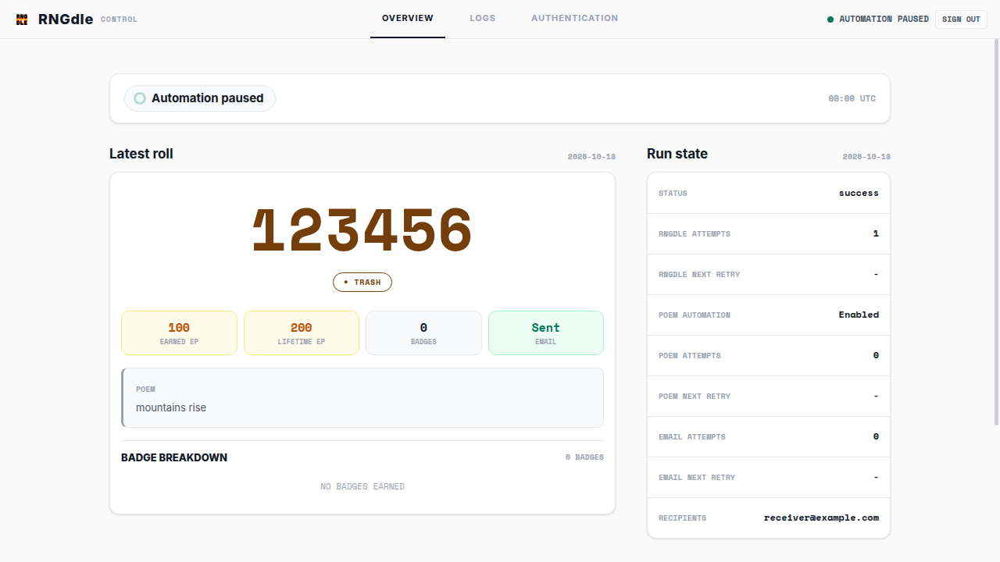

# RNGdle Automation

Astro 控制台与 Cloudflare Workers 每日自动化服务。默认每天按配置时区执行 RNGdle roll，可选生成并提交诗歌，再通过 SMTP 发送结果邮件。



## 功能

- Astro SSR 控制台：Overview、Logs、Authentication、Settings、登录与首次密码设置
- 同源 `/api/*` 与邮件预览接口，实际邮件与预览使用同一模板
- SQLite Durable Object 持久化 Cookie、45 天每日状态、运行时配置、Control 密码哈希、Session、登录限流与最近日志
- Durable Object Alarm 调度 `roll → poem → email`，每个阶段独立持久化和重试
- 写操作与 Alarm 串行执行，对象重启后从已完成阶段恢复
- 登录失效时暂停任务并提示重新认证，提交 magic link 后恢复
- 保留可选 DeepSeek / OpenAI 兼容 LLM 作诗，生成后先做词块与质量校验再提交

## 本地开发

需要 Node.js 22.12+ 和 pnpm 11：

```bash
pnpm install
pnpm test
pnpm test:e2e
pnpm build
```

浏览器测试使用独立 workerd 与临时 SQLite 存储，不访问真实 SMTP、LLM 或 RNGdle 账号。若未安装 Chromium，先运行 `pnpm exec playwright install chromium`。

如需本地连接真实服务，先准备 `.env` 与 Worker secrets。`.env`、`.dev.vars`、`data/`、`backups/` 均已被忽略。

## Deploy to Cloudflare

1. 登录 Cloudflare 并准备配置：

```bash
pnpm install
pnpm exec wrangler login
cp .env.example .env
# 填写 RNGDLE_EMAIL、SMTP_*、MAIL_*，以及可选 LLM_* 配置
```

2. 创建生产专用 Wrangler 配置。`wrangler.production.jsonc` 已被忽略，可以安全填写你的域名：

```bash
cp wrangler.jsonc wrangler.production.jsonc
```

编辑 `wrangler.production.jsonc`：

- `name`：你的 Worker 名称
- `vars.CONTROL_PUBLIC_URL`：你的 `workers.dev` 或自定义域名 HTTPS 地址
- `vars.ALLOW_SETUP`：首次部署设为 `"true"`，完成 Control 密码设置后改回 `"false"`
- 如使用自定义域名，按 Cloudflare zone 添加 `routes`
- `env.staging` 可删除；生产配置不需要它

3. 从 `.env` 生成 Worker secrets。输出文件包含 SMTP、LLM、RNGdle 账号等敏感信息，不要提交：

```bash
pnpm cloudflare:init https://your-worker-name.your-subdomain.workers.dev
pnpm exec wrangler secret bulk data/cloudflare-secrets.json --config wrangler.production.jsonc
```

4. 构建并部署：

```bash
pnpm deploy:production
```

5. 打开 `CONTROL_PUBLIC_URL`，按页面完成 Control 密码设置。确认可登录后，将 `ALLOW_SETUP` 改为 `"false"`，再次运行 `pnpm deploy:production`。

6. 在 Authentication 页面提交 RNGdle magic link，完成登录后启用自动任务：

```bash
MIGRATION_ORIGIN=https://your-worker-name.your-subdomain.workers.dev pnpm cloudflare resume
```

> Workers 使用 Durable Objects。请勿删除 `AUTOMATION` 命名空间或修改实例名 `primary`，否则会丢失登录 Cookie、历史状态、运行时配置和 Control 密码。

## 运行行为

- 默认调度：上海时间 `08:02`，可在 Settings 修改时区和时间
- RNGdle 失败默认 30 分钟重试，诗歌 5 分钟，邮件 1 分钟
- 已完成日期直接跳过；已有 roll 或诗歌会复用，不重复生成或提交
- SMTP 密码在 Settings 中留空表示保留，且不会通过 API 返回
- Control Session 使用 Secure、HttpOnly Cookie，写操作要求同源和 CSRF Token
- SMTP 接受邮件后、状态保存前中断仍可能导致重复投递，系统不承诺严格一次发送

## 从旧 Docker 部署迁移

导出命令需要显式提供旧服务器和项目路径，不会内置任何服务器地址：

```bash
CONTROL_PUBLIC_URL=https://your-worker-name.your-subdomain.workers.dev \
  pnpm cloudflare export data/legacy-snapshot.json user@example-host /path/to/RNGdle-Automation
```

导出包含旧环境实际配置、Cookie、每日状态、诗歌草稿、运行时设置和 Control 密码哈希；旧 Session 与文件锁不迁移。文件按 `0600` 保存，包含敏感数据。

导入目标必须为空，重复导入会返回 `409`，不会覆盖线上数据：

```bash
MIGRATION_ORIGIN=https://your-worker-name.your-subdomain.workers.dev \
  pnpm cloudflare import data/legacy-snapshot.json
```

原 Control 密码继续有效，但需要重新登录。导入后先验证，再启用调度：

```bash
pnpm cloudflare verify smtp
pnpm cloudflare verify rngdle
pnpm cloudflare resume
```

`verify poem` 会读取实时词库并调用模型生成与校验候选，不覆盖已有诗歌；`verify email` 会真实发送一次结果邮件。

## 管理与备份

管理工具通过 `/__migration/*` 和独立 Bearer Token 访问。Token 保存在被忽略的 `data/cloudflare-migration.json`，可用 `MIGRATION_CREDENTIALS` 指定其他路径，`MIGRATION_ORIGIN` 临时覆盖目标地址。

```bash
pnpm cloudflare status
pnpm cloudflare pause
pnpm cloudflare resume
pnpm cloudflare backup backups/workers.json
```

备份包含配置、Cookie、每日状态、设置和密码哈希。恢复时先向空 Worker 导入，再验证并启用调度。

## 配置与安全

`CONFIG_JSON` 是包含基础配置及 SMTP、LLM 凭证的 Worker Secret；`MIGRATION_TOKEN` 是管理工具密钥，不是 Control 密码。二者都不会发送到前端。

生产 `CONTROL_PUBLIC_URL` 固定为 Wrangler 配置中的 HTTPS 地址，旧迁移备份中的 URL 不会覆盖它。生产构建不读取本地 `.env` 作为开发变量。旧 Docker 运维说明见 [legacy-docker.md](docs/legacy-docker.md)。

技术依据：[Astro Cloudflare 适配器](https://docs.astro.build/en/guides/integrations-guide/cloudflare/)、[Durable Object Alarms](https://developers.cloudflare.com/durable-objects/api/alarms/)、[Workers TCP sockets](https://developers.cloudflare.com/workers/runtime-apis/tcp-sockets/)。
