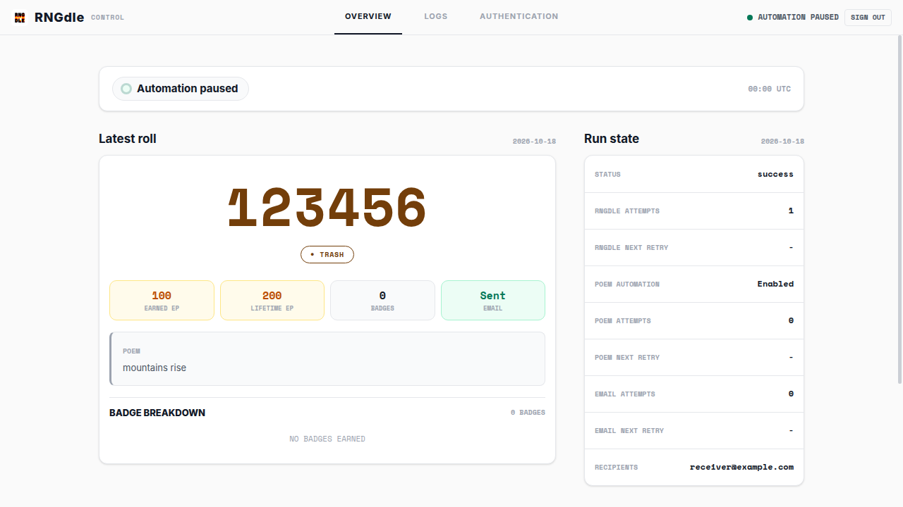

# RNGdle Automation

Astro 控制台与 Cloudflare Workers 每日自动化服务。每天在 UTC `00:00` 执行 RNGdle roll，可选生成并提交诗歌，再通过 SMTP 发送结果邮件。

[](https://deploy.workers.cloudflare.com/?url=https://github.com/Insouciant21/RNGdle-Automation)



## 功能

- Astro SSR 控制台：Overview、Logs、Authentication，通过 Secret 配置密码登录
- 同源 `/api/*` 与邮件预览接口，实际邮件与预览使用同一模板
- SQLite Durable Object 持久化 Cookie、45 天每日状态、Session、登录限流与最近日志
- Durable Object Alarm 调度 `roll → poem → email`，每个阶段独立持久化和重试
- 写操作与 Alarm 串行执行，对象重启后从已完成阶段恢复
- 登录失效时暂停任务并提示重新认证，提交 magic link 后恢复
- 可选回赞：轮询新的 `heart_received` 通知，为对方最近 7 天内的 roll 回点一次心；首启建立基线，默认关闭
- 保留可选 DeepSeek / OpenAI 兼容 LLM 作诗，生成后先做词块与质量校验再提交

## 本地开发

使用 [mise](https://mise.jdx.dev/getting-started.html) 管理本地 Node.js 和 pnpm，并提供开发、测试、构建及部署任务。Node.js 版本读取 `.node-version`，pnpm 版本读取 `package.json` 的 `packageManager`，本地无需启用 Corepack。

```bash
mise trust
mise install
mise run install
mise run test
mise run build
```

`mise tasks` 可查看所有命令；`mise run test:e2e` 运行浏览器测试，`mise run check` 同时运行单元和浏览器测试。开发、测试、构建及部署任务会先安装锁文件中的依赖。

浏览器测试使用独立 workerd 与临时 SQLite 存储，不访问真实 SMTP、LLM 或 RNGdle 账号。若未安装 Chromium，先运行 `mise run browsers:install`。

浏览器测试还需要 Chromium 的系统运行库；Debian/Ubuntu 可用 `mise run browsers:install --with-deps` 一并安装。

如需本地连接真实服务，将 `.dev.vars.example` 复制为 `.dev.vars` 并填写账号及凭证，然后运行 `mise run dev`。本地也使用 workerd 与 Durable Object；`.dev.vars`、`data/`、`backups/` 均已被忽略。

## 运行行为

- 每日任务固定在 UTC `00:00`（北京时间 `08:00`）执行，任务日期按 UTC 计算
- RNGdle 失败默认 30 分钟重试，诗歌 5 分钟，邮件 1 分钟
- 邮件发件人名称固定为 `RNGdle Today`，标题前缀固定为 `[RNGdle]`
- 已完成日期直接跳过；已有 roll 或诗歌会复用，不重复生成或提交
- 回赞默认每 60 分钟检查一次，每天最多 10 次；同一用户的多个通知只回赞一次，已有自己的心或 roll 过旧时跳过
- SMTP、重试、回赞和 LLM 配置来自独立的 Workers 变量/Secret，修改后重新部署生效
- Control Session 使用 Secure、HttpOnly Cookie，写操作要求同源和 CSRF Token
- SMTP 接受邮件后、状态保存前中断仍可能导致重复投递，系统不承诺严格一次发送

## 管理与备份

管理工具通过 `/__migration/*` 和独立 Bearer Token 访问。Token 保存在被忽略的 `data/cloudflare-migration.json`，可用 `MIGRATION_CREDENTIALS` 指定其他路径，`MIGRATION_ORIGIN` 临时覆盖目标地址。

```bash
mise run cloudflare status
mise run cloudflare pause
mise run cloudflare resume
mise run cloudflare backup backups/workers.json
```

备份包含配置、Cookie、每日状态和回赞去重记录。恢复时先向空 Worker 导入，再验证并启用调度；登录密码沿用目标 Worker 的 `CONTROL_PASSWORD` Secret。旧版备份仍可导入，其中的 Control 密码哈希不会恢复。

## 配置与安全

项目仅支持 Cloudflare Workers。配置示例 `.dev.vars.example` 只列必填项与常用功能开关；重试、回赞和 LLM 参数已有默认值，可通过 `wrangler.jsonc` 或 Workers Builds 变量覆盖。每日任务固定在 UTC `00:00`，HTTP/SMTP 超时固定为 45 秒，LLM 请求超时固定为 60 秒。凭证和个人邮箱使用 Secret，构建脚本会过滤这些值。`MIGRATION_TOKEN` 是管理工具密钥，不是 Control 密码；SMTP、LLM 和管理凭证不会发送到前端。

| 变量 | 类型 | 默认 | 说明 |
| --- | --- | --- | --- |
| `RETRY_MINUTES` / `EMAIL_RETRY_MINUTES` | var | `30` / `1` | RNGdle / 邮件重试间隔 |
| `RNGDLE_EMAIL` | Secret | 必填 | RNGdle 账号邮箱 |
| `SMTP_HOST`、`SMTP_PORT`、`SMTP_SECURE`、`SMTP_REQUIRE_TLS` | var | 见 wrangler.jsonc | SMTP 传输 |
| `SMTP_USER`、`MAIL_TO` | Secret | 必填 | 发件账号与收件人邮箱 |
| `MAIL_FROM` | Secret | `SMTP_USER` | 仅发件地址不同时填写 |
| `SMTP_PASSWORD` | Secret | 密码认证时必填 | SMTP 凭证 |
| `SMTP_AUTH_MODE`、`SMTP_OAUTH_*` | var / Secret | `password` | 认证方式（OAuth 凭证为 Secret） |
| `POEM_ENABLED`、`POEM_RETRY_MINUTES` | var | `false` / `5` | 诗歌开关 |
| `LLM_ENDPOINT`、`LLM_MODEL`、`LLM_MAX_TOKENS`、`LLM_MAX_ATTEMPTS`、`LLM_THINKING` | var | 见 wrangler.jsonc | 作诗模型参数 |
| `LLM_API_KEY` | Secret | 开启诗歌时必填 | 作诗模型密钥 |
| `RETURN_LIKES_*` 四项 | var | 关 / `60`/`10`/`7` | 回赞参数 |
| `CONTROL_PUBLIC_URL` | var | 必填 | 控制台公网地址 |
| `CONTROL_SESSION_DAYS` | var | `7` | 登录会话天数 |
| `CONTROL_PASSWORD` | Secret | 必填 | 控制台密码，8–512 个字符；修改后旧会话失效 |
| `MIGRATION_TOKEN` | Secret | 必填 | 管理与备份接口密钥 |

`SMTP_AUTH_MODE=oauth2` 时改用 `SMTP_OAUTH_*` 四项，无需 `SMTP_PASSWORD`。

可见覆盖值通过 Workers Builds 变量或 Wrangler 配置提供，凭证用 `mise run wrangler secret put <NAME>`。`mise run cloudflare init <url>` 从 `.dev.vars` 和 Workers 变量生成本地配置文件；`mise run cloudflare secrets` 上传其中的凭证，也可指定 Workers 备份文件。

`mise run deploy` 按 Workers Builds 变量构建并部署。使用本地专属配置时，`mise run deploy:production` 会合并被忽略的 `wrangler.production.jsonc` 与 `data/cloudflare-secrets.json` 中的非敏感覆盖值，再按同一份配置构建并部署；可加 `--dry-run` 仅验证构建与打包。修改变量后需重新部署生效。

Cloudflare Workers Builds 的构建命令设为 `pnpm run build:workers`，部署命令设为 `pnpm run deploy`。云端使用 Cloudflare 原生工具链与自动依赖安装，Node.js 和 pnpm 版本分别读取 `.node-version` 与 `package.json` 的 `packageManager`。移除已有的 `SKIP_DEPENDENCY_INSTALL` 构建变量，无需配置 `NODE_VERSION` 或 `PNPM_VERSION`。本地可用 `mise run deploy`，或运行 `pnpm run deploy:workers` 完成构建和部署。

生产 `CONTROL_PUBLIC_URL` 固定为 Wrangler 配置中的 HTTPS 地址，备份中的 URL 不会覆盖它。Control 密码由 `CONTROL_PASSWORD` Secret 管理，可在 Cloudflare 控制台修改，或运行 `mise run wrangler secret put CONTROL_PASSWORD`。Durable Object 只保存会话和登录限流记录，修改密码后旧会话失效。Cookie 始终启用 Secure；运行配置从 Worker 绑定读取，本地通过 `.dev.vars` 提供。

技术依据：[Astro Cloudflare 适配器](https://docs.astro.build/en/guides/integrations-guide/cloudflare/)、[Durable Object Alarms](https://developers.cloudflare.com/durable-objects/api/alarms/)、[Workers TCP sockets](https://developers.cloudflare.com/workers/runtime-apis/tcp-sockets/)。
